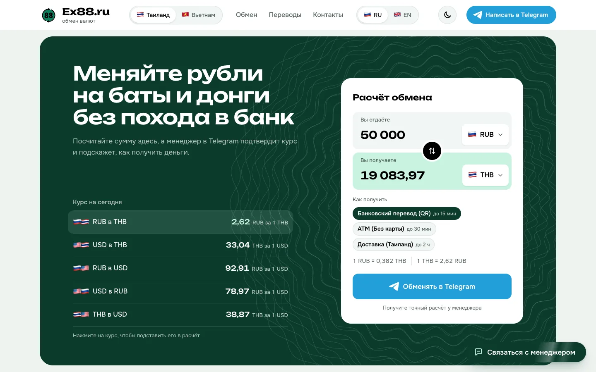
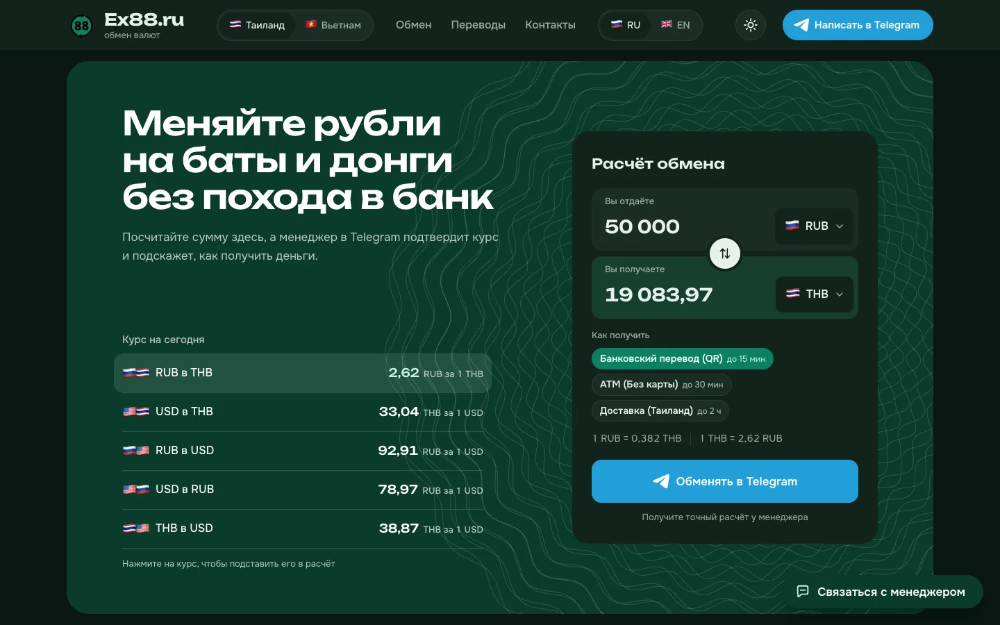
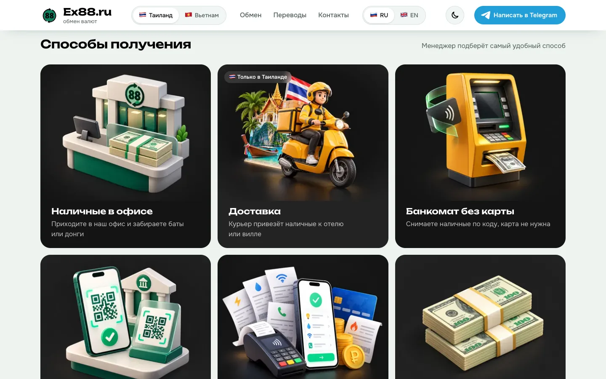
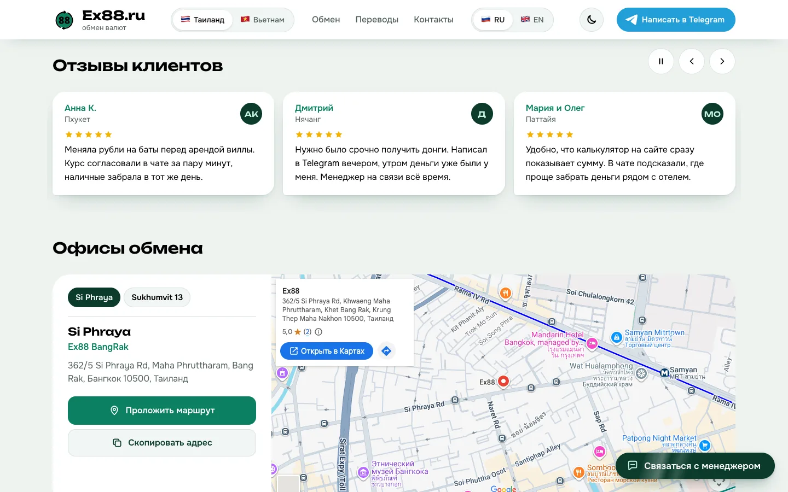
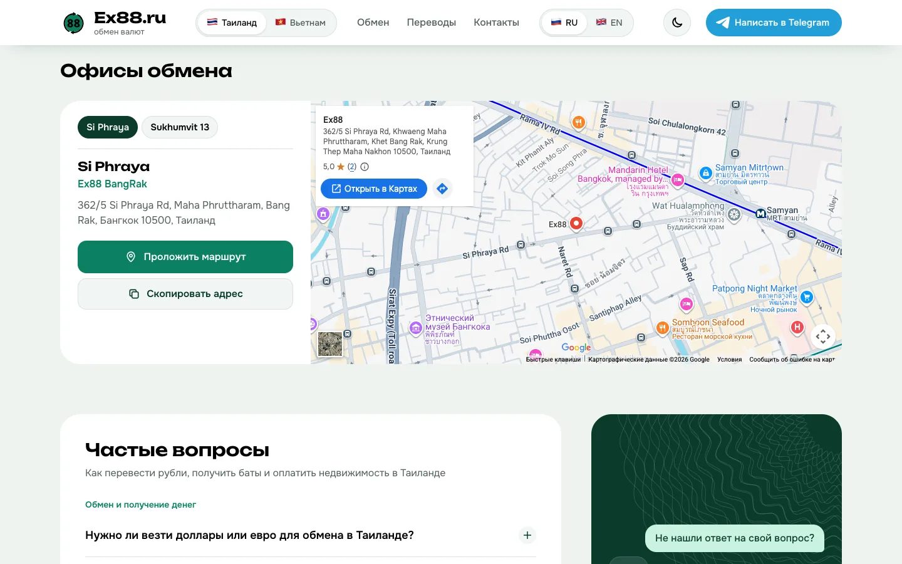
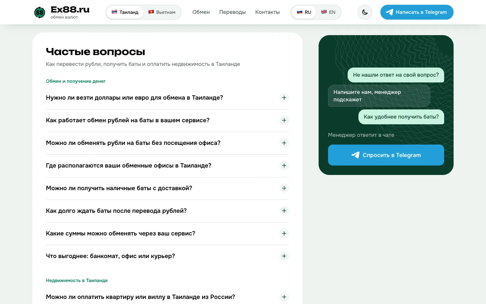
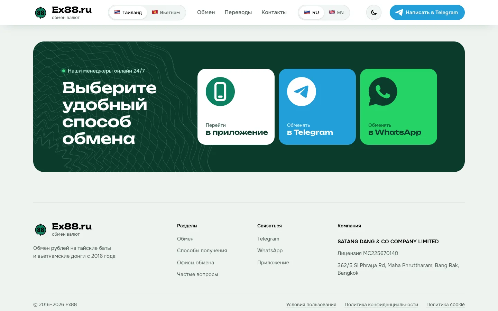
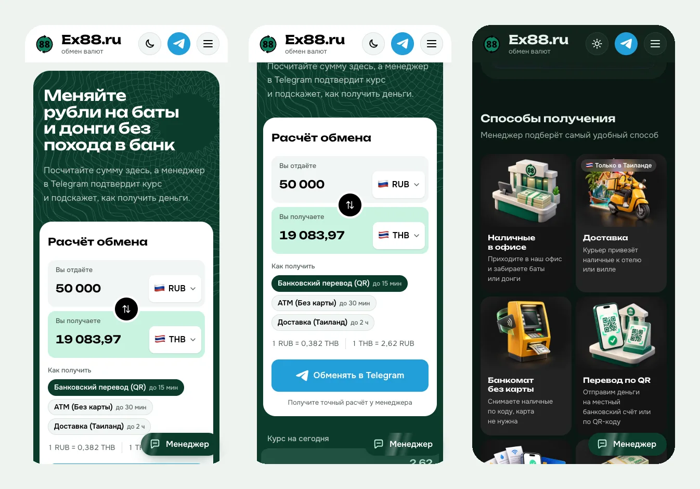

<div align="center">


# Ex88.ru

**Лендинг сервиса обмена рублей на тайские баты и вьетнамские донги**

Посетитель считает обмен по живому курсу прямо на сайте и продолжает в Telegram с менеджером.

[**Открыть сайт →**](https://gleeful-hotteok-49571d.netlify.app)


</div>



## О проекте

Ex88 помогает туристам и тем, кто живёт в Таиланде и Вьетнаме, обменять рубли без похода в банк: перевести рубли с российской карты и получить баты или донги в офисе, через банкомат без карты или курьером.

Задача сайта простая: за несколько секунд показать, сколько человек получит, и привести его в чат с менеджером с уже заполненной суммой.

Визуальный язык взят из мира денег: тёмно-зелёный цвет купюр, медленно колышущиеся гильош-линии, как на банкнотах, и знак обмена из логотипа.

## Что внутри

### Живой калькулятор обмена

- Курсы, список «Курс на сегодня» и сама сумма приходят из **EX-88 API**. Расчёт делает сервер, ровно как в боте, с теми же диапазонами сумм и округлением.
- Выбор **способа получения** (банковский перевод по QR, банкомат без карты, доставка): у способа может быть свой курс.
- Курс видно **в обе стороны** (`1 RUB = 0,382 THB │ 1 THB = 2,62 RUB`): люди привыкли считать и так, и так.
- Проверка минимальной суммы, переключатель «Таиланд / Вьетнам», обмен валют местами, анимированный пересчёт результата.
- Пока сервер отвечает, видно состояние загрузки: блик на заготовках строк и вращающиеся стрелки из логотипа.

| Светлая тема | Тёмная тема |
|---|---|
|  |  |

### Способы получения

Шесть способов в шахматной сетке с 3D-иллюстрациями: наличные в офисе, доставка, банкомат без карты, перевод по QR, оплата услуг и счетов, доллары онлайн.



### Отзывы и офисы

- Бесконечный слайдер отзывов с автопрокруткой, паузой и свайпом на телефоне.
- Офисы с переключателем, картой Google, кнопками «Проложить маршрут» и «Скопировать адрес» (латиницей, чтобы показать таксисту или вставить в Grab).





### Частые вопросы

Аккордеон из 13 вопросов (открыт всегда только один) и карточка с живой перепиской: посетитель спрашивает, менеджер «печатает» и отвечает.



### Связь с менеджером

Блок с каналами связи (приложение, Telegram, WhatsApp), плавающая кнопка «Связаться с менеджером» на всех страницах и футер с реквизитами компании.



### На телефоне

Вёрстка mobile-first, проверена на 375, 768, 1024 и 1440px.



## Возможности

- 🌗 **Светлая и тёмная тема.** Сначала берётся из настроек системы, выбор запоминается.
- 🌐 **Русский и английский.** Все тексты, подписи для скринридеров и формат чисел (`50 000,00` / `50,000.00`) переключаются на лету.
- ♿ **Доступность.** Семантическая разметка, работа с клавиатуры, видимый фокус, `aria`-подписи. Всё, что движется само, ставится на паузу, а при `prefers-reduced-motion` спокойнее или выключено.
- ⚡ **Лёгкость.** Без фреймворков и сборки. Картинки в WebP двух размеров, анимации только на `transform` и `opacity`.
- 🔎 **SEO.** Отдельный адрес на каждый язык (`/ru`, `/en`), `canonical`, `hreflang`, Open Graph, JSON-LD (Organization, WebSite, FAQPage, BreadcrumbList), `robots.txt` и `sitemap.xml`: всё собирает `scripts/build.mjs`.
- 📄 **Документы.** Условия пользования, политика конфиденциальности и политика cookie на двух языках.

## Технологии

| | |
|---|---|
| Разметка и стили | HTML5, CSS3 (переменные, `color-mix`, `:has`, контейнерные сетки) |
| Логика | Vanilla JavaScript, без зависимостей |
| Данные | [EX-88 API](https://ex-88.pro/docs): `GET /api/rates`, `POST /api/exchange/calculate` |
| Карта | Google Maps embed |
| Шрифты | Unbounded (заголовки), Onest (текст), лежат в `assets/fonts` |
| Хостинг | Netlify |

## Структура

```
ex88/
├── index.html          # Главная страница
├── terms.html          # Условия пользования
├── privacy.html        # Политика конфиденциальности
├── cookies.html        # Политика cookie
├── assets/
│   ├── style.css       # Все стили и дизайн-токены
│   ├── reset.css
│   ├── js/main.js      # Тема, язык, калькулятор, слайдер, офисы, FAQ
│   ├── fonts/          # Onest и Unbounded (WOFF2, по подмножествам)
│   └── img/            # Логотип, значки банков, иллюстрации (WebP), картинки для соцсетей
├── scripts/build.mjs   # Production-сборка в dist/
├── deploy/nginx.conf   # Те же редиректы и заголовки для nginx
├── netlify.toml        # Сборка на Netlify
├── reports/            # Замеры Lighthouse до и после оптимизации
├── docs/screenshots/   # Скриншоты для этого README
└── CLAUDE.md           # Правила проекта: дизайн, анимации, языки, контент
```

## Запуск локально

Сборка не нужна, это статический сайт.

```bash
git clone https://github.com/Ceyhun1999/ex88.git
cd ex88
python3 -m http.server 8000
# открыть http://127.0.0.1:8000
```

### Production-сборка

```bash
node scripts/build.mjs      # пишет dist/, Node 18+, без зависимостей
npx serve dist              # те же адреса, что на ex88.ru: /ru, /en, /ru/terms…
```

Сборка делает из исходников страницы `/ru`, `/en`, `/ru|en/terms`, `/ru|en/privacy`, `/ru|en/cookies` (английский текст уже в HTML), встраивает CSS, добавляет `canonical`, `hreflang`, Open Graph и JSON-LD, хэширует скрипт и пишет `robots.txt`, `sitemap.xml`, `_redirects` и `_headers` для Netlify. На Netlify сборка запускается сама (`netlify.toml`); для nginx есть `deploy/nginx.conf`. Подробности и замеры: `SEO_PERFORMANCE_REPORT.md`.

> API курсов пускает запросы только с адреса сайта (CORS). Локально калькулятор покажет «Курс временно недоступен», пока адрес `127.0.0.1` не добавят на стороне API или пока запросы к `/api/*` не идут через прокси.

## Перед запуском в продакшн

- [ ] Заменить заглушки ссылок в начале `assets/js/main.js`: `WHATSAPP_NUMBER` (Telegram-ссылки `BOT_URL` и `APP_URL` уже заданы).
- [ ] Заменить демо-отзывы в `REVIEWS` на настоящие (с разрешения клиентов).
- [ ] Добавить боевой домен в CORS на стороне EX-88 API.
- [ ] Настроить `www.ex88.ru` (DNS и сертификат) с редиректом на `https://ex88.ru`.
- [ ] После выкладки отправить `https://ex88.ru/sitemap.xml` в Google Search Console и Яндекс Вебмастер.
- [ ] Вернуть бегущую строку курсов, если она нужна (сейчас скрыта в шапке `index.html`).

---

<div align="center">
<sub>Сделано <a href="https://github.com/Ceyhun1999">Jeywa Studio</a> для Ex88 · SATANG DANG &amp; CO COMPANY LIMITED</sub>
</div>
